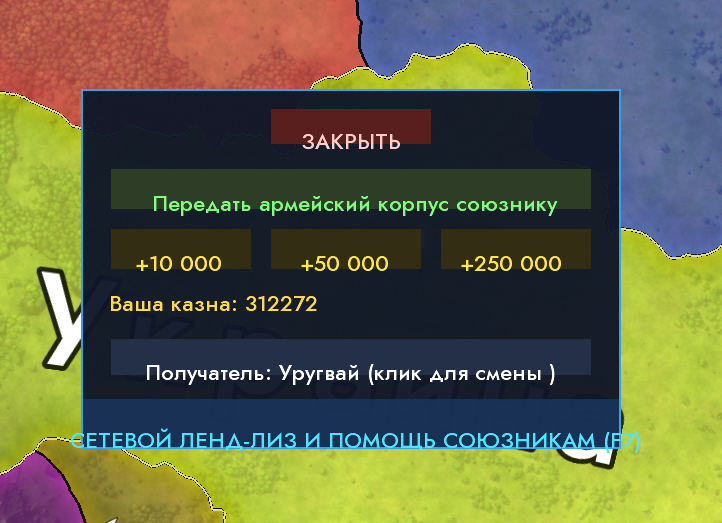
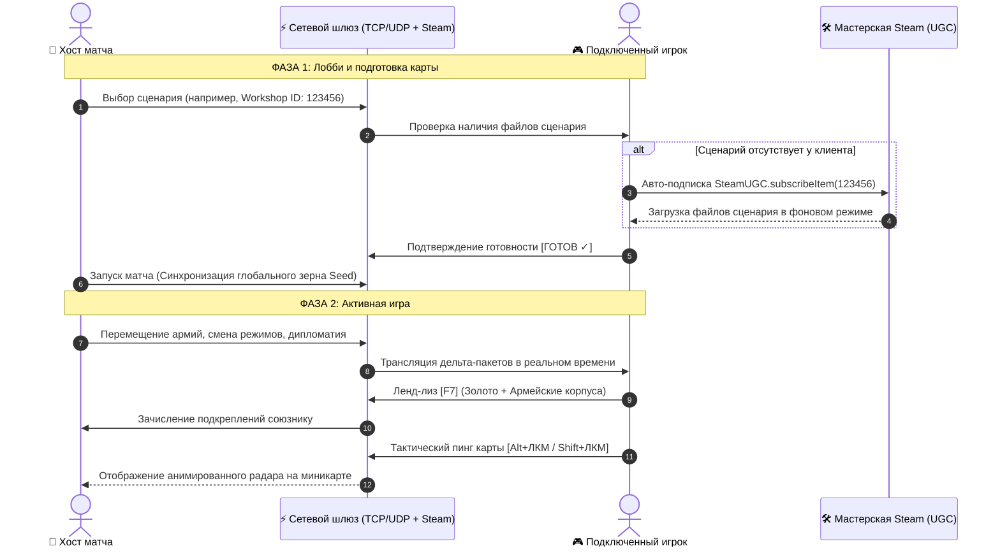

# ⚡ Age of Clicks — Multiplayer Mod & ModLoader

<div align="center">


**Монументальная сетевая модификация и модульный загрузчик для гранд-стратегии *Age of Clicks*.**  
*Полноценный сетевой режим, синхронизация карт мастерской Steam, ленд-лиз, тактический чат, ядерная тревога DEFCON 1 и хот-реконнект.*

[📥 Скачать релиз v1.2.0](https://github.com/MisterPugs/Age-of-Clicks-Multiplayer-Mod/releases/latest) • [🎮 Возможности](#-основные-возможности) • [⌨️ Управление](#️-горячие-клавиши) • [📦 Установка](#-установка-для-игроков)

</div>

---

## 📸 Демонстрация игрового процесса

<div align="center">
  
  <p><i>Интерфейс гранд-стратегии с интеграцией сетевого лобби, тактических пингов, чата и системы помощи союзникам</i></p>
</div>

---

## 🏗️ Архитектура сетевой синхронизации



---

## 🚀 Основные возможности

### 🌐 1. Сетевой Мультиплеер (LAN, Direct IP, Steam P2P)
- Подключение до **8 игроков** в один матч без десинхронизаций.
- Выделенный браузер комнат по локальной сети и поддержка прямого подключения по IP / Steam-приглашениям.
- Хост контролирует скорость игры, исключая рассинхрон тиков симуляции.

### 🗺️ 2. Расширенный выбор сценариев и авто-скачивание из Steam Workshop
- Интерактивный диалог выбора сценариев с вкладками:
  - 🌐 **Все сценарии**
  - 🌟 **Официальные сценарии**
  - 🛠️ **Steam Workshop (Мастерская)**
- **Авто-докачка карт**: Если хост выбрал сценарий из мастерской, у клиента без этого мода появляется кнопка `[ ⬇️ СКАЧАТЬ В STEAM ]`. Нажатие автоматически подписывает игрока через `SteamUGC` и открывает страницу загрузки в оверлее Steam!

### 🤝 3. Сетевой Ленд-Лиз и Передача Дивизий [F7]
- **Выбор любой державы мира** стрелками `[ ◀ ПРЕД ]` / `[ СЛЕД ▶ ]` или через всплывающий интерактивный список.
- Фильтр отображения: `Только союзники` / `Все государства мира`.
- Мгновенная передача золота: `+10 000 🪙`, `+50 000 🪙`, `+250 000 🪙`.
- Прямая передислокация дивизий под управление союзного генштаба.
- **Полная блокировка кликов сквозь меню**: карта и войска под окном помощи защищены от случайных нажатий.

### 💾 4. Сетевые сохранения и Hot-Reconnect [F6]
- Хост может сохранить прогресс многопользовательской кампании в любой момент по клавише `F6` (в каталог `saves/mp/`).
- **Защита от вылетов**: При случайном обрыве связи игрок перезаходит в матч и моментально восстанавливает контроль над своей страной.

### 🚨 5. Ядерная тревога DEFCON 1
- При запуске межконтинентальных баллистических ракет (МБР) на экранах всех участников срабатывает сирена DEFCON 1, периметр вспыхивает красным пульсирующим предупреждением, а вверху экрана активируется тактический таймер до ядерного удара.

### 💬 6. Тактический чат и пинги по карте
- Открытие чата на `Enter` или `T` (общение с союзниками или глобальный канал).
- **Пинги по карте**:
  - `Alt + ЛКМ` — боевой маркер атаки цели с звуковым сигналом.
  - `Shift + ЛКМ` — защитный маркер обороны рубежа.

### 📊 7. Сетевая таблица матча [Tab]
- Удержание `Tab` выводит экран сводки в стиле кибер-табло: число подконтрольных регионов, численность вооружённых сил, казна, доход, статус готовности и сетевой пинг каждого участника.

### 👁️ 8. Режим Наблюдателя / Судьи (Spectator Mode)
- Игроки могут занять слот зрителя в лобби, чтобы наблюдать за битвами без управления государствами (идеально для турниров и стримов).

### 📜 9. Моддинг скриптов (Lua / JavaScript) и Hot-Reload [F5]
- Встроенная среда выполнения Lua и JS (`mods/scripts/`).
- Поддержка перехвата игровых событий (объявление войн, захват столиц, торговля).
- Горячая перезагрузка всех модов и интерфейсов по клавише `F5` без перезапуска игры.

---

## ⌨️ Горячие клавиши

| Клавиша / Комбинация | Действие |
| :--- | :--- |
| **`F7`** | Открыть интерактивное меню Ленд-лиза и военной помощи |
| **`F6`** | Сохранить сетевой матч (для хоста, каталог `saves/mp/`) |
| **`Tab`** | Показать сетевую таблицу счёта, казны, армий и пинга |
| **`Enter` / `T`** | Открыть внутриигровой тактический чат |
| **`Alt + ЛКМ`** | Поставить атакующий маркер цели на карте для союзников |
| **`Shift + ЛКМ`**| Поставить оборонительный маркер на карте для союзников |
| **`F5`** | Мгновенный Hot-Reload скриптов, модов и стилей |
| **`ESC`** | Закрыть модальные диалоги или выйти в меню паузы |

---

## 📦 Установка для игроков

1. Перейдите в раздел **[Releases](https://github.com/MisterPugs/Age-of-Clicks-Multiplayer-Mod/releases/latest)** и скачайте архив `Age_of_Clicks_Multiplayer_Mod.zip`.
2. В клиенте Steam нажмите правой кнопкой мыши по **Age of Clicks** ➔ **Управление** ➔ **Просмотреть локальные файлы**.
3. Распакуйте папки `app` и `mods` из скачанного архива прямо в корень игры (с подтверждением замены файлов).
4. Запустите игру через Steam как обычно — в главном меню появится кнопка **«СЕТЕВАЯ ИГРА»**!

---

## 🛠️ Сборка из исходников для разработчиков

```powershell
# Клонирование репозитория
git clone https://github.com/MisterPugs/Age-of-Clicks-Multiplayer-Mod.git
cd Age-of-Clicks-Multiplayer-Mod

# Компиляция JAR-модулей
powershell -ExecutionPolicy Bypass -File .\build_all.ps1

# Сборка готового ZIP-архива для распространения
powershell -ExecutionPolicy Bypass -File .\package_for_friend.ps1
```

---

<div align="center">
  <b>Age of Clicks Multiplayer Mod</b> • Создано сообществом для стратегов
</div>
