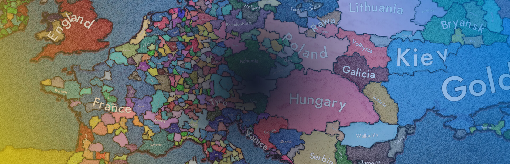
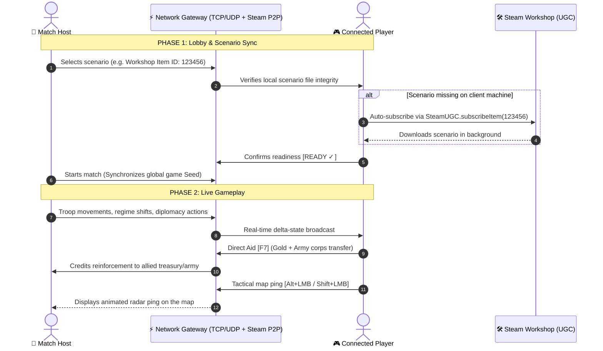

# ⚡ Age of Clicks — Multiplayer Mod & ModLoader

  

### 🌐 FULL-FEATURED ONLINE MULTIPLAYER & MODLOADER FOR AGE OF CLICKS

**Extensive online multiplayer modification and modding framework for *Age of Clicks*:**  
*Online matches up to 8 players, Steam Workshop scenario auto-sync, Lend-Lease aid, DEFCON 1 nuclear alert, tactical in-game chat, map pings, hot-reconnect, and multiplayer save system. Fully cross-compatible between PC and Android!*

[ 🇷🇺 Читать на русском языке ](README_RU.md) • [ 🇬🇧 Read in English ](README.md)

[📥 Download PC Mod (v1.2.0 ZIP)](https://github.com/MisterPugs/Age-of-Clicks-Multiplayer-Mod/releases/latest) • [📱 Download Android Client (.apk)](https://github.com/MisterPugs/Age-of-Clicks-Multiplayer-Mod/releases/latest) • [🎮 Key Features](#-key-features) • [📦 Quick Installation](#-quick-installation)

---

## 🏗️ Network Synchronization Architecture

---

## 🚀 Key Features

### 🌐 1. Online Multiplayer (LAN, Direct IP, Steam P2P)
- Up to **8 players** in a single match without desyncs.
- Built-in LAN room discovery browser and direct IP / Steam invite connectivity.
- Host-controlled game speed to eliminate simulation tick discrepancies.

### 🗺️ 2. Expanded Scenario Selector & Steam Workshop Auto-Download
- Categorized scenario browser with dedicated tabs:
  - 🌐 **All Scenarios**
  - 🌟 **Official Scenarios**
  - 🛠️ **Steam Workshop Maps**
- **Automated Workshop Sync**: When the host chooses a Workshop map, clients who do not possess it receive a prominent `[ ⬇️ DOWNLOAD ON STEAM ]` button that auto-subscribes via Steam UGC and opens the item page.

### 🤝 3. Direct Lend-Lease & Troop Transfer [F7]
- **Target any nation worldwide** using quick arrows `[ ◀ PREV ]` / `[ NEXT ▶ ]` or the searchable country picker.
- Toggle between `Allies Only` and `All Nations`.
- Instant treasury donations: `+10,000 🪙`, `+50,000 🪙`, `+250,000 🪙`.
- Instant corps transfer to allied command.
- **Strict Anti-Click-Through**: Dialog absorbs all clicks so provinces and armies underneath are never triggered by mistake.

### 💾 4. Match Saves & Hot-Reconnect [F6]
- Host can save multiplayer campaigns on the fly via `F6` (saved to `saves/mp/`).
- **Disconnect Protection**: If a player loses connection or restarts, they can rejoin and immediately resume command of their country.

### 🚨 5. DEFCON 1 Nuclear Alert System
- When an ICBM is launched, all connected players hear the DEFCON 1 klaxon, screen edges pulse red, and a tactical countdown shows remaining seconds until nuclear impact.

### 💬 6. Tactical In-Game Chat & Map Pings
- Open chat with `Enter`, `T`, or clicking the bottom-left hud trigger.
- **Full mouse controls**: `[ ✉️ SEND ]`, `[ ✖ CLOSE ]`, `[ 🌐 GLOBAL / 🤝 TEAM ]`, plus outside-click defocus to prevent getting trapped in typing mode.
- **Tactical Map Pings**:
  - `Alt + LMB` — Attack objective marker with tactical alert sound.
  - `Shift + LMB` — Defensive rally marker for allies.

### 📊 7. In-Game Tab Scoreboard
- Holding `Tab` displays real-time match statistics: controlled regions, armed forces, treasury, and live ping with vertically centered typography.

### 👁️ 8. Observer / Spectator Mode
- Players can join as neutral spectators to watch matches unfold (ideal for tournaments and streaming).

### 🌍 9. First-Launch Language Selector
- Clean bilingual modal prompt (Russian & English with official flags) upon first launch.
- Remembers player preference permanently and automatically configures all mod menus and game text.

### 📱 11. Mobile Tactical HUD (Android APK Exclusive)
- Seamless top dock bar designed specifically for Android touch screens (`ApplicationType.Android`):
  - `[ 💬 CHAT ]` — Toggles on-screen virtual keyboard and multiplayer chat.
  - `[ 🤝 AID ]` — Opens Lend-Lease & troop transfer interface.
  - `[ 🕊️ DIPLO ]` — Opens full diplomacy modal.
  - `[ 📊 SCORE ]` — Toggles match scoreboard.
  - `[ ⏸️ PAUSE ]` — Requests tactical timeout.
  - `[ 📈 TIMELINE ]` — Opens post-game growth curves and ranking screen.
- *Strictly disabled on PC to preserve classic hotkey gameplay and keep screen uncluttered.*

### 🕊️ 12. Full Multiplayer Diplomacy [F8]
- Formal Non-Aggression Pacts & Military Alliances.
- Mutual military defense and joint war engagements.
- Network offer proposals with bilateral Accept/Reject popup notifications.
- Alliance dissolution and formal declaration of war.

### 📈 13. Timeline & Post-Game Match Graphs [F9]
- Multi-curve visual growth charts tracking territorial expansion and army strength throughout the campaign.
- Match leader rankings and post-battle prestige awards (MVP Conqueror, Grand General).

### ⏸️ 14. Tactical Pause & Synchronized Game Speed [Pause] / [P]
- 45-second emergency timeout (up to 2 timeouts per player per match) with network-wide countdown banner and instant resume button.
- Synchronized simulation speed (1x, 2x, 5x) to maintain deterministic simulation across all connected clients.

---

## ⌨️ Hotkeys & Controls

| Key / Shortcut | Action |
| :--- | :--- |
| **`F7`** | Open Direct Aid & Lend-Lease Dialog |
| **`F8`** | Open Multiplayer Diplomacy Modal |
| **`F9`** | Open Match Timeline & Post-Game Growth Graphs |
| **`Pause` / `P`**| Request 45-second Tactical Pause / Vote Speed |
| **`F6`** | Save Multiplayer Match (Host only, `saves/mp/`) |
| **`Tab`** | Show Match Scoreboard (Treasury, Army, Ping) |
| **`Enter` / `T`** | Open Tactical Chat |
| **`Alt + LMB`** | Place Attack Ping on Map |
| **`Shift + LMB`**| Place Defense Ping on Map |
| **`F5`** | Hot-Reload Mods and Scripts on the fly |
| **`ESC`** | Close open dialogs or return to Pause Menu |

---

## 📦 Quick Installation

### 💻 PC (Steam):
1. Navigate to **[Releases](https://github.com/MisterPugs/Age-of-Clicks-Multiplayer-Mod/releases/latest)** and download `Age_of_Clicks_Multiplayer_Mod.zip`.
2. In your Steam Library, right-click **Age of Clicks** ➔ **Manage** ➔ **Browse local files**.
3. Extract `app` and `mods` folders from the zip directly into the game root directory (overwrite existing files when prompted).
4. Launch the game via Steam — the **"MULTIPLAYER"** button will appear on the main menu!

### 📱 Android (Cross-Play Ready):
1. Download `Age_of_Clicks_Multiplayer_v1.2.0.apk` from **[Releases](https://github.com/MisterPugs/Age-of-Clicks-Multiplayer-Mod/releases/latest)**.
2. Install the `.apk` on your Android device (allow installation from unknown sources if prompted).
3. Launch the game — multiplayer is pre-installed! Connect to PC or Android hosts over local Wi-Fi / LAN, or via Direct IP (Radmin VPN / hotspot).

---

  <b>Age of Clicks Multiplayer Mod</b> • Built for strategists worldwide

