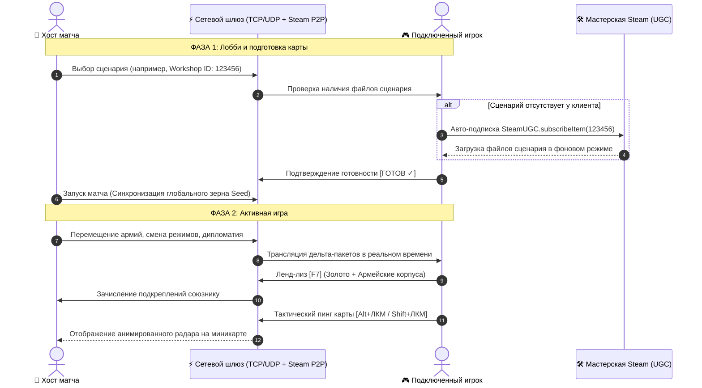

# ⚡ Age of Clicks — Multiplayer Mod & ModLoader

  

### 🌐 ПОЛНОЦЕННЫЙ СЕТЕВОЙ МУЛЬТИПЛЕЕР И МОДЛОАДЕР ДЛЯ AGE OF CLICKS

**Масштабная сетевая модификация для гранд-стратегии *Age of Clicks*:**  
*Битвы по сети до 8 игроков, синхронизация сценариев мастерской Steam, ленд-лиз, ядерная тревога DEFCON 1, тактический чат, пинги и сетевые сохранения. Полный кросс-плей между ПК и Android!*

[ 🇷🇺 Читать на русском языке ](README_RU.md) • [ 🇬🇧 Read in English ](README.md)

[📥 Скачать мод для ПК (v1.2.0 ZIP)](https://github.com/MisterPugs/Age-of-Clicks-Multiplayer-Mod/releases/latest) • [📱 Скачать Android клиент (.apk)](https://github.com/MisterPugs/Age-of-Clicks-Multiplayer-Mod/releases/latest) • [🎮 Возможности](#-основные-возможности) • [📦 Быстрая установка](#-быстрая-установка)

---

## 🏗️ Архитектура сетевой синхронизации

---

## 🚀 Основные возможности

### 🌐 1. Сетевой Мультиплеер (LAN, Direct IP, Steam P2P)
- Подключение до **8 игроков** в один матч без десинхронизаций.
- Выделенный браузер комнат по локальной сети и поддержка прямого подключения по IP / Steam-приглашениям.
- Хост контролирует скорость игры, исключая рассинхрон тиков симуляции.

### 🗺️ 2. Расширенный выбор сценариев и авто-докачка из Steam Workshop
- Интерактивный диалог выбора сценариев с вкладками:
  - 🌐 **Все сценарии**
  - 🌟 **Официальные сценарии**
  - 🛠️ **Steam Workshop (Мастерская)**
- **Авто-докачка карт**: Если хост выбрал сценарий из мастерской, у клиента без этого мода появляется кнопка `[ ⬇️ СКАЧАТЬ В STEAM ]`. Нажатие автоматически подписывает игрока через `SteamUGC` и открывает страницу загрузки в оверлее Steam!

### 🤝 3. Сетевой Ленд-Лиз и Передача Дивизий [F7]
- **Выбор любой державы мира** стрелками `[ ◀ ПРЕД ]` / `[ СЛЕД ▶ ]` или через всплывающий интерактивный список.
- Фильтр отображения: `Только союзники` / `Все государства мира`.
- Мгновенная передача золота: `+10 000 🪙`, `+50 000 🪙`, `+250 000 🪙`.
- Прямая передислокация дивизий под управление союзного генштаба.
- **Полная блокировка кликов сквозь меню**: карта и войска под окном помощи защищены от случайных нажатий.

### 💾 4. Сетевые сохранения и Hot-Reconnect [F6]
- Хост может сохранить прогресс многопользовательской кампании в любой момент по клавише `F6` (в каталог `saves/mp/`).
- **Защита от вылетов**: При случайном обрыве связи игрок перезаходит в матч и моментально восстанавливает контроль над своей страной.

### 🚨 5. Ядерная тревога DEFCON 1
- При запуске межконтинентальных баллистических ракет (МБР) на экранах всех участников срабатывает сирена DEFCON 1, периметр вспыхивает красным пульсирующим предупреждением, а вверху экрана активируется тактический таймер до ядерного удара.

### 💬 6. Тактический чат с мышью и пинги по карте
- Открытие чата на `Enter`, `T` или кликом по плашке внизу экрана.
- **Полное управление мышью**: кнопки `[ ✉️ ОТПРАВИТЬ ]`, `[ ✖ ЗАКРЫТЬ ]`, `[ 🌐 ОБЩИЙ / 🤝 СОЮЗ ]` и клик вне окна для мгновенного закрытия без застревания в режиме набора.
- **Пинги по карте**:
  - `Alt + ЛКМ` — боевой маркер атаки цели с звуковым сигналом.
  - `Shift + ЛКМ` — защитный маркер обороны рубежа.

### 📊 7. Сетевая таблица матча [Tab]
- Удержание `Tab` выводит экран сводки в стиле кибер-табло: число подконтрольных регионов, численность вооружённых сил, казна, статус готовности и сетевой пинг каждого участника с идеальным центрированием строк.

### 👁️ 8. Режим Наблюдателя / Судьи (Spectator Mode)
- Игроки могут занять слот зрителя в лобби, чтобы наблюдать за битвами без управления государствами (идеально для турниров и стримов).

### 📱 10. Мобильный тактический HUD (Эксклюзивно для Android APK)
- Верхняя кибер-панель быстрого доступа, созданная специально под сенсорные экраны смартфонов и планшетов (`ApplicationType.Android`):
  - `[ 💬 ЧАТ ]` — вызов виртуальной клавиатуры и тактического чата.
  - `[ 🤝 ПОМОЩЬ ]` — окно передачи золота и дивизий союзникам.
  - `[ 🕊️ ДИПЛО ]` — полноценная мультиплеерная дипломатия.
  - `[ 📊 СЧЁТ ]` — таблица матча и сетевой статус.
  - `[ ⏸️ ПАУЗА ]` — запрос тактического таймаута на 45 секунд.
  - `[ 📈 ИТОГИ ]` — графики роста империй и турнирные награды.
- *Строго отключен на ПК-версии игры, чтобы не перегружать экран и оставить управление классическим хоткеям.*

### 🕊️ 11. Полноценная мультиплеерная дипломатия [F8]
- Пакты о ненападении и официальные военные союзы.
- Совместные боевые действия и автоматическая взаимовыручка в войнах.
- Двусторонняя сетевая система предложений с интерактивным окном принятия/отклонения.
- Разрыв альянсов и прямое объявление войны.

### 📈 12. Экран итогов матча (Timeline & Post-Game Graphs) [F9]
- Интерактивные многоцветные кривые развития территорий и численности армий во времени.
- Итоговая турнирная таблица и памятные медали (MVP Завоеватель, Великий Полководец).

### ⏸️ 13. Тактическая пауза и голосование за скорость [Pause] / [P]
- Сетевой таймаут на 45 секунд (до 2 пауз на игрока за матч) с баннером обратного отсчёта и кнопкой досрочного пуска.
- Синхронное переключение скорости симуляции (1x, 2x, 5x) без рассинхронов игрового мира.

---

## ⌨️ Горячие клавиши

| Клавиша / Комбинация | Действие |
| :--- | :--- |
| **`F7`** | Открыть интерактивное меню Ленд-лиза и военной помощи |
| **`F8`** | Открыть полноценную мультиплеерную дипломатию |
| **`F9`** | Открыть экран итогов матча с графиками территорий и войск |
| **`Pause` / `P`**| Запросить тактическую паузу на 45 сек / голосование за скорость |
| **`F6`** | Сохранить сетевой матч (для хоста, каталог `saves/mp/`) |
| **`Tab`** | Показать сетевую таблицу счёта, казны, армий и пинга |
| **`Enter` / `T`** | Открыть внутриигровой тактический чат |
| **`Alt + ЛКМ`** | Поставить атакующий маркер цели на карте для союзников |
| **`Shift + ЛКМ`**| Поставить оборонительный маркер на карте для союзников |
| **`F5`** | Мгновенный Hot-Reload скриптов, модов и стилей |
| **`ESC`** | Закрыть модальные диалоги или выйти в меню паузы |

---

## 📦 Быстрая установка

### 💻 ПК (Steam):
1. Перейдите в раздел **[Releases](https://github.com/MisterPugs/Age-of-Clicks-Multiplayer-Mod/releases/latest)** и скачайте архив `Age_of_Clicks_Multiplayer_Mod.zip`.
2. В клиенте Steam нажмите правой кнопкой мыши по **Age of Clicks** ➔ **Управление** ➔ **Просмотреть локальные файлы**.
3. Распакуйте папки `app` и `mods` из скачанного архива прямо в корень игры (с подтверждением замены файлов).
4. Запустите игру через Steam как обычно — в главном меню появится кнопка **«СЕТЕВАЯ ИГРА»**!

### 📱 Android (Кросс-плей с ПК):
1. Скачайте файл `Age_of_Clicks_Multiplayer_v1.2.0.apk` из раздела **[Releases](https://github.com/MisterPugs/Age-of-Clicks-Multiplayer-Mod/releases/latest)**.
2. Установите `.apk` на смартфон или планшет Android (при необходимости разрешите установку из внешних источников).
3. Запустите игру — сетевой мод уже встроен в клиент! Подключайтесь к друзьям по локальной сети Wi-Fi / Direct IP или играйте через VPN / мобильную точку доступа.

---

  <b>Age of Clicks Multiplayer Mod</b> • Создано сообществом для стратегов

